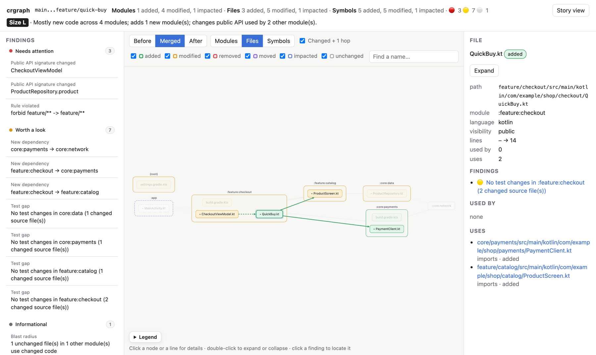
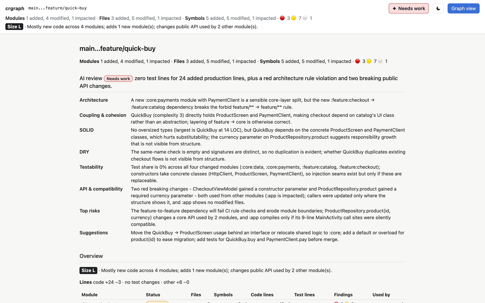
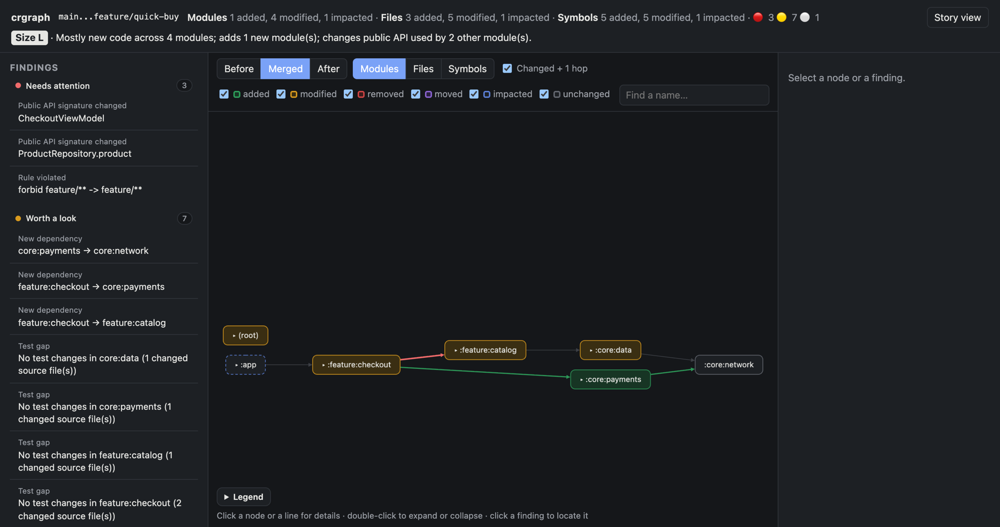
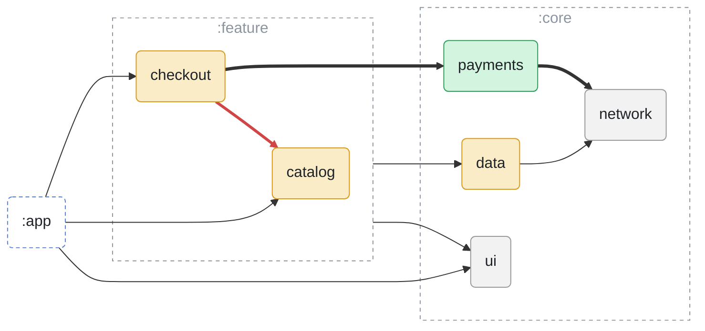
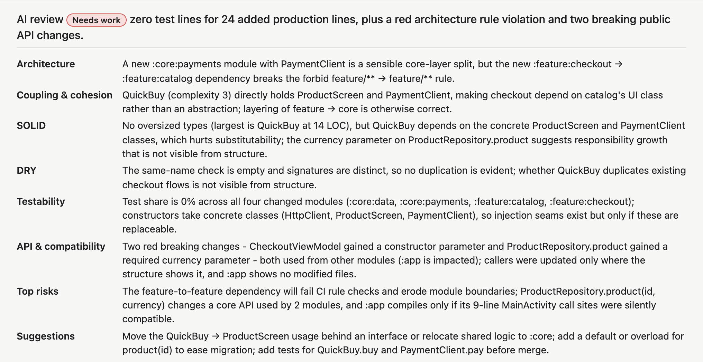

# crgraph

[](https://github.com/lukisk/crgraph/actions/workflows/ci.yml)
[](pyproject.toml)
[](LICENSE)

**Architecture-level code review for git diffs.** crgraph shows what a change does to the structure of a
codebase: which modules, files, classes and functions changed, which dependencies appeared or disappeared, and
what a reviewer should look at first. It never shows code.

**[Try the live demo](https://lukisk.github.io/crgraph/demo/report.html)** · [Project site](https://lukisk.github.io/crgraph/)



A line diff tells you *what text* changed. crgraph tells you *what the change means for the architecture*:

- `:feature:checkout` now depends on `:feature:catalog`, and that breaks a layering rule
- `ProductRepository.product` changed its signature, and two other modules call it
- a new module `:core:payments` appeared
- four modules changed code without touching their tests

It runs locally on any git repository, needs no server and no build, and works on Kotlin, Swift,
TypeScript/JavaScript, Python, Go and PHP.

## Install

You need Python 3.11+ and git. Install crgraph as a command with [uv](https://docs.astral.sh/uv/) or
[pipx](https://pipx.pypa.io/):

```sh
uv tool install git+https://github.com/lukisk/crgraph
# or
pipx install git+https://github.com/lukisk/crgraph
```

To upgrade, run `uv tool upgrade crgraph` (or `pipx upgrade crgraph`). To pin a release, append it to the URL:
`git+https://github.com/lukisk/crgraph@v0.6.0`.

Language grammars download on first use. For CI images or offline machines, run `crgraph grammars fetch` once.

## Quick start

Run crgraph inside a repository:

```sh
crgraph main...feature     # what a merge request shows (since the merge base)
crgraph                    # your uncommitted changes (HEAD vs working tree)
```

crgraph opens the report in your browser. It keeps one HTML file per repository in a private temp folder and
overwrites it on every run, so nothing is written to your project.

### Ranges

| Command | Compares |
|---|---|
| `crgraph main...feature` | the merge base of `main` and `feature` with `feature`, like an MR |
| `crgraph main..feature`, `crgraph main feature` | two refs directly |
| `crgraph abc123 def456` | two commits |
| `crgraph main` | `main` with your working tree |
| `crgraph` | `HEAD` with your working tree |
| `crgraph --staged` | `HEAD` with the index |
| `crgraph main...feature -- app/` | only changes under `app/` |

### Saving reports

To keep the files, for example in CI, pass `--generate` (`-g`). The files go to `./crgraph-out/`, or to the
directory given with `-o`:

```sh
crgraph main...feature -g                # report.html, summary.md and delta.json in ./crgraph-out/
crgraph main...feature -o review --open  # write to ./review/ and open the report
crgraph main...feature --format md       # only summary.md
crgraph main...feature --format md --depth symbol  # summary.md down to changed symbols
```

| File | What it is |
|---|---|
| `report.html` | one self-contained interactive page, no network needed |
| `summary.md` | a Mermaid diagram and a findings table, ready to paste into a GitHub PR or GitLab MR comment; with `--depth file` or `--depth symbol` the diagram shows files or symbols and a table lists every changed file or symbol (signatures before → after) |
| `delta.json` | the machine-readable change description (`schema_version: 1`) |

## The report

**Findings** (left) are grouped into *Needs attention*, *Worth a look* and *Informational*. Click one to see
where it is in the graph.

**The graph** (middle) nests modules ⊃ files ⊃ classes and functions:

- Colours show what changed: green added, amber modified, red removed, purple moved, dashed blue impacted
  (unchanged code that uses changed code).
- *Before*, *Merged* and *After* switch between the old structure, both combined, and the new one.
- *Modules*, *Files* and *Symbols* set how deep the graph goes. Double-click a box to expand or collapse it.
- *Tests* shows or hides test modules, files and symbols (those matching `test_patterns`). It only appears
  when the change touches test code.
- Click a box to highlight all its connections. Click a line to see which code creates that dependency.
- Drag anywhere to pan, also on a box. Shift+drag or middle-drag moves a box.
- ☾/☀ in the header switches between dark and light (it follows the system until you pick one).

**Details** (right) show the selected element's path, signature, size, complexity, callers and findings.

**Story view** turns the whole change into one readable page you can print: an overview, then each finding with
a small map you can click.

<p>
  
  
</p>

Every output starts with an **Overview** of the whole change:

- a verdict: what kind of change it is, where it lives, and whether it adds modules, changes public API used
  elsewhere, adds cycles or touches independent areas
- a review size, `S`/`M`/`L`/`XL`, from changed production lines (S < 200, M < 800, L < 2000) and the number of
  modules with code changes (2–3 modules mean at least M, 4 or more at least L)
- lines added and removed for production code, tests and everything else
- a per-module table: files, symbols added/removed/changed/moved, code and test lines, findings, dependents
- **Start here**: the five production files to review first, ranked by findings, callers, complexity increase,
  churn and size, each with its reasons

`summary.md` contains the same overview plus a module diagram that GitHub and GitLab render. For the change in
the screenshot it looks like this:



## Findings

| Rule | Severity | Meaning |
|---|---|---|
| `new-cycle` | 🔴 | a new module or file dependency cycle |
| `rule-violation` | 🔴 | an added dependency breaks a rule in `.crgraph.yml` |
| `api-change` | 🔴/🟡 | public API removed, narrowed or re-signed (🔴 when other modules use it) |
| `module-dep-added` / `-removed` | 🟡/⚪ | module dependency changes, declared or through imports |
| `coupling-increase` | 🟡 | a module's outgoing dependencies grew a lot |
| `complexity` | 🟡 | a function's complexity jumped or crossed the ceiling |
| `test-gap` | 🟡 | changed code without matching test changes |
| `external-dep-added` | 🟡 | a new Gradle, SwiftPM, npm, pip, Go or Composer dependency |
| `contract-surface` | 🟡 | manifests, plists, migrations, env vars or HTTP routes changed |
| `analysis-config` | 🟡 | the change edits `.crgraph.yml` (findings still use the base version) |
| `blast-radius` | ⚪/🟡 | unchanged code in other modules that uses changed code |
| `splittable` | ⚪ | the change splits into independent groups; consider splitting the MR |
| `dead-on-arrival` | ⚪ | new public symbols nobody calls |
| `hotspot` | ⚪ | changed files that are both churny and complex |
| `owners` | ⚪ | CODEOWNERS groups touched |

## Use in CI

crgraph exits with `1` when a finding reaches the `--fail-on` severity (`red` by default), `0` otherwise, and
`2` on usage errors. To report without failing the job, use `--fail-on never`.

**GitHub Actions**: add the summary to the job page and keep the report as an artifact.

```yaml
crgraph:
  runs-on: ubuntu-latest
  steps:
    - uses: actions/checkout@v5
      with: { fetch-depth: 0 }
    - uses: astral-sh/setup-uv@v7
    - run: uv tool install git+https://github.com/lukisk/crgraph@v0.6.0
    - run: crgraph origin/${{ github.base_ref }}...HEAD -g --fail-on never
    - run: cat crgraph-out/summary.md >> "$GITHUB_STEP_SUMMARY"
    - uses: actions/upload-artifact@v4
      with: { name: crgraph, path: crgraph-out/ }
```

**GitLab CI**:

```yaml
crgraph:
  image: ghcr.io/astral-sh/uv:python3.12-bookworm
  rules: [{ if: $CI_MERGE_REQUEST_IID }]
  variables: { GIT_DEPTH: 0 }
  script:
    - uv tool install git+https://github.com/lukisk/crgraph@v0.6.0
    - ~/.local/bin/crgraph origin/$CI_MERGE_REQUEST_TARGET_BRANCH_NAME...HEAD -g --fail-on red
  artifacts: { when: always, paths: [crgraph-out/], expose_as: crgraph report }
```

crgraph needs the history up to the merge base, so use a full clone (`fetch-depth: 0` / `GIT_DEPTH: 0`).

## Configuration

All settings are optional. crgraph reads `.crgraph.yml` from the repository root as of the **base** revision, so
a change cannot relax the rules it is reviewed with. To try an edited config, pass `--config .crgraph.yml`.

```yaml
modules:                       # glob -> module id overrides
  "app/src/main/kotlin/com/example/routes/**": routes
ignore: ["**/*.pb.kt"]         # added to the defaults (build/, generated/, node_modules/, …)
test_patterns: ["**/*Spec.kt"] # added to the defaults
contract_files: ["**/featureflags/**"]
rules:
  - forbid: { from: "feature/**", to: "feature/**" }                  # features stay independent
  - forbid: { from: "**", to: "**:impl", except_from: "**/di/**" }    # only DI sees implementations
  - layers: { order: [ui, presentation, domain, data], match: "**/{layer}/**" }
thresholds: { blast_modules: 5, fanout_delta: 3, complexity_delta: 5, complexity_max: 15 }
explain: { model: claude-opus-5-5, include_signatures: true, plain: false }
```

## Options

| Option | |
|---|---|
| `-g`, `--generate` | write files instead of only opening the report |
| `-o DIR`, `--out DIR` | output directory (default `crgraph-out`); implies `--generate` |
| `--format html,md,json` | which files to write; implies `--generate` |
| `--open` | with `--generate`, also open the report |
| `--depth module\|file\|symbol` | how deep the report's graph starts, and how deep `summary.md` goes |
| `--fail-on red\|yellow\|never` | exit 1 when findings reach this severity (default `red`) |
| `--config PATH` | use this config file instead of the base revision's `.crgraph.yml` |
| `--staged` | compare with the index instead of the working tree |
| `--explain` | add an AI architecture review (see below) |
| `-q`, `--quiet` | no progress line while crgraph works (it only shows on a terminal, never in CI logs or pipes) |
| `--version` | print the version |

### AI architecture review

`--explain` asks a model whether the change is in good shape. The answer starts with a verdict, **Good**,
**Acceptable** or **Needs work**, and the main reason. It then gives one line each on architecture, coupling and
cohesion, SOLID, DRY, testability, API compatibility, the top risks and concrete suggestions. Every line names
the modules, types or numbers it is based on.



The model never sees code. It gets module, file and symbol names, statuses, signatures, sizes, complexity,
dependency changes, the overview and the findings, plus a hint about new types whose name already exists
elsewhere (possible duplication). Where the structure cannot show something, the review says so instead of
guessing.

The verdict is a ✦ button in the report header; clicking it opens the full review in the story view.
`summary.md` shows it as a table. `delta.json` has the raw text in `explain` and the parsed review in `review`.

It needs `ANTHROPIC_API_KEY`, `ant auth login` or your own proxy (below).

### Explain through your own LLM proxy

Any proxy that accepts the Anthropic Messages API (`POST /v1/messages`, as LiteLLM and most gateways do) works.
Put the connection in your personal config, `~/.config/crgraph/config.yml` (or `$XDG_CONFIG_HOME/crgraph/`):

```yaml
explain:
  model: <model name in your proxy>
  base_url: https://llm-proxy.example.com     # without /v1
  auth_token_env: LLM_PROXY_TOKEN             # the variable that holds the token
  # auth_token_command: "security find-generic-password -s llm-proxy -w"   # or a command that prints it
  # auth_token: <token>                       # or the token itself (the file must be chmod 600)
  # token_header: x-api-key                   # default: Authorization: Bearer
  plain: true                                 # only standard request fields, for non-Claude models
```

- Settings here override the repository's `explain` settings.
- `base_url` and the token settings are only accepted in this file. A repository's `.crgraph.yml` cannot send
  your summary or token somewhere else.
- When no token is configured here, the usual `ANTHROPIC_API_KEY` / `ANTHROPIC_AUTH_TOKEN` variables are used.

## How it works

1. **Modules** come from build files: Gradle settings and build scripts, `Package.swift` or
   `<Module>/Sources/` folders, `package.json` (including workspaces), `pyproject.toml`, `go.mod` and
   `composer.json`. In Go every package directory is a module named by its import path; in PHP every directory
   under a PSR-4 autoload root is a module named by its namespace (`App\Service`), so imports resolve to files.
   Files outside any of these are grouped by folder.
2. **Files** changed in the range are parsed on both sides with [tree-sitter](https://tree-sitter.github.io/):
   classes, functions, signatures, visibility, complexity and imports.
3. **Dependencies** are resolved from imports and names, then extended one hop to the unchanged code that uses
   what changed.
4. The before and after graphs are compared into a **delta**, then the analyses produce findings.

**Accuracy**: module dependencies come from build files and are exact. Class and function calls are matched by
name and imports, without type information, so they are drawn dashed and labelled heuristic.

**Privacy**: everything runs locally. The report contains names, paths, signatures and metrics, never source
code.

## Development

```sh
git clone https://github.com/lukisk/crgraph && cd crgraph
uv venv && uv pip install -e '.[dev]'
.venv/bin/pytest
.venv/bin/ruff check
```

See [CONTRIBUTING.md](CONTRIBUTING.md) for the project layout, how to add a language, and how releases work.

## License

MIT, see [LICENSE](LICENSE). The report embeds Cytoscape.js and cytoscape-dagre, also MIT; see
[THIRD_PARTY_NOTICES.md](THIRD_PARTY_NOTICES.md).
